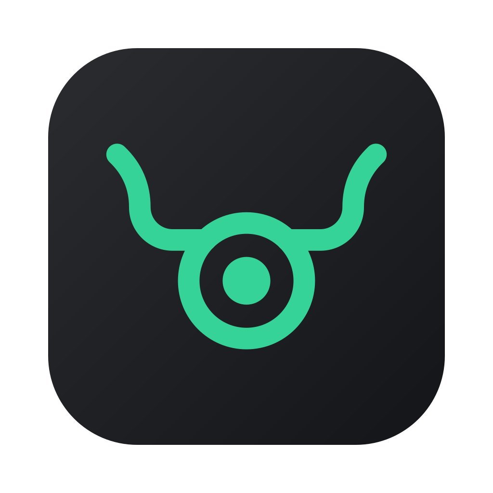
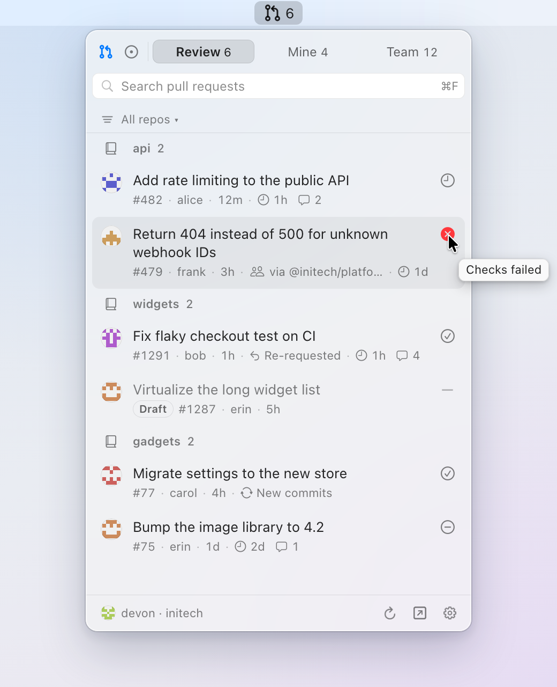
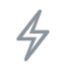
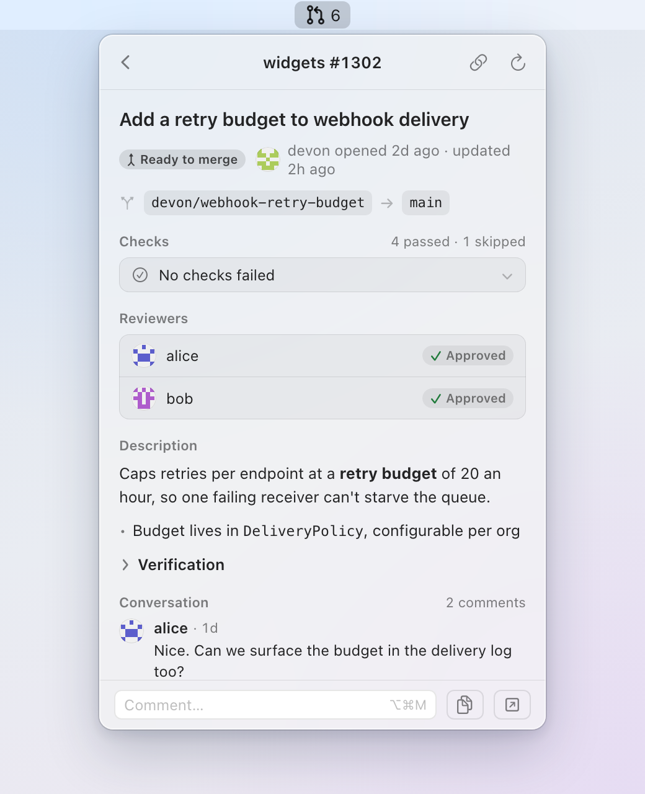
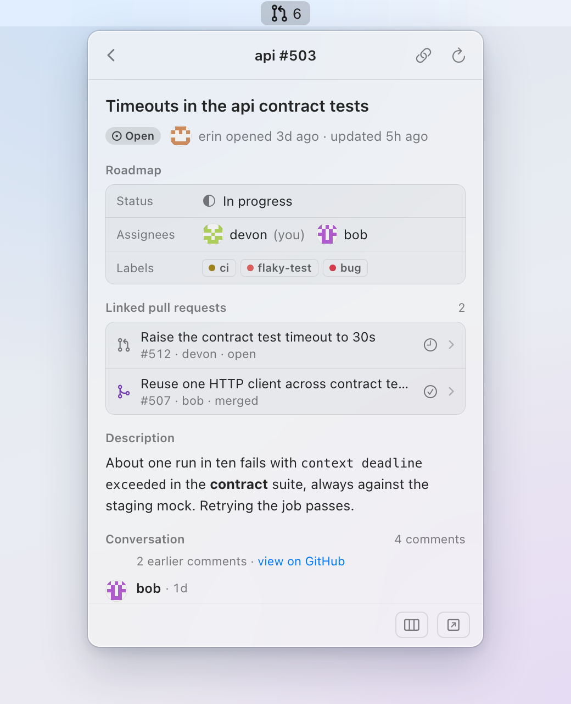
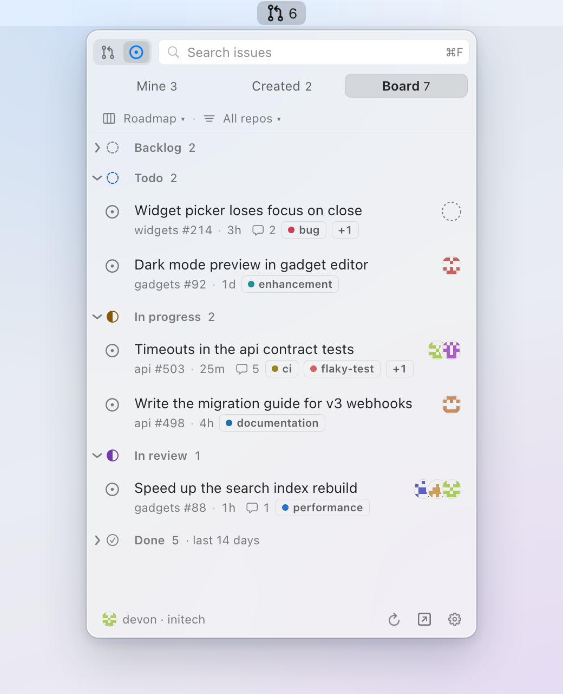
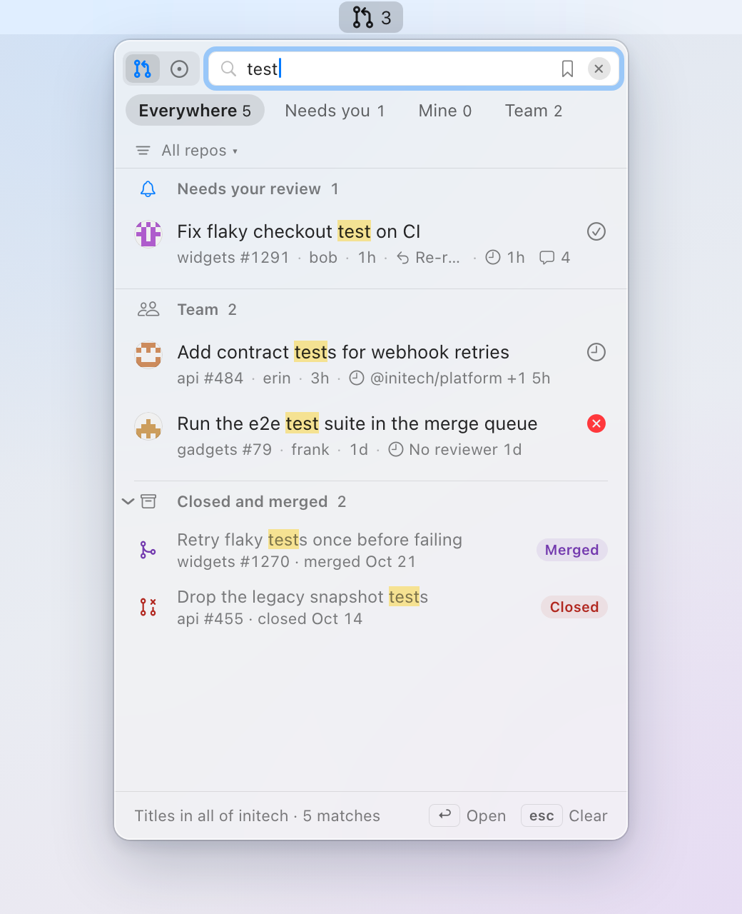

<div align="center">



# PullBull

**GitHub pull requests, issues and Projects boards in the macOS menu bar.**

Keyboard-first · Native SwiftUI · Edits only what you pick

[](https://github.com/rustycamper/pullbull/releases/latest)
[](https://github.com/rustycamper/pullbull/actions/workflows/ci.yml)
[](#requirements)
[](#install)
[](LICENSE)

[Install](#install) · [Lists](#lists) · [Search](#search) · [Keys](#keys) · [Settings](#settings) · [Privacy](#privacy) · [Manual](docs/manual.md)

<picture>
  <source media="(prefers-color-scheme: dark)" srcset="docs/media/popover-dark.png">
  
</picture>

</div>

## Problem → solution

| &emsp;&emsp; | Problem | PullBull |
|:-:|---|---|
|  | Review requests get lost among CI, mentions and bot comments | **Needs your review**, first in the list, with only PRs waiting on you or your team. Count in the menu bar |
|  | You remember what a PR or issue was about, not its title or number; a chat mentions one loosely | **Ask AI**: describe it in your own words (<kbd>⌥</kbd><kbd>⌘</kbd><kbd>Return</kbd>), answered by Anthropic with your own API key. Off by default |
|  | Agents open PRs faster than you can track them | **Your PRs**: what needs you, apart from what waits on others. Review state, checks, *Ready to merge* when approved and green |
|  | Re-requests and new commits after your review go unnoticed | Both land back in **Needs your review**, marked with why |
|  | The Projects board is slow for a quick look | **Mine** and **Board** issue tabs, grouped by board Status |
|  | Finding the PR that closes an issue takes clicks | Issue detail lists its linked PRs. Open one, <kbd>Esc</kbd> returns |
|  | Answering a question in a thread means opening the browser | **Comment** from the detail, <kbd>⌥</kbd><kbd>⌘</kbd><kbd>M</kbd>, `@` to tag people, <kbd>⌘</kbd><kbd>Return</kbd> to send |
|  | "Where is #123?" means opening a browser | <kbd>⌃</kbd><kbd>⌥</kbd><kbd>P</kbd>, type `#123` or paste the link, <kbd>Return</kbd> |
|  | Work and personal GitHub accounts mean signing out and back in | Switch accounts on the fly from the footer (<kbd>⌘</kbd><kbd>⇧</kbd><kbd>A</kbd>). Each comes back with its own org and board |
|  | Notifications are all or nothing | Toggle each event separately |
|  | Web UIs make you reach for the mouse | Keyboard-first. Every action has a key; start typing anywhere to search |
|  | Most dev tools are web apps in a window | Native SwiftUI and AppKit, no web views. System materials, light and dark, VoiceOver, Reduce Motion |

## Screens

| Pull request detail | Issue detail |
|:-:|:-:|
| <picture><source media="(prefers-color-scheme: dark)" srcset="docs/media/pr-detail-dark.png"></picture> | <picture><source media="(prefers-color-scheme: dark)" srcset="docs/media/issue-detail-dark.png"></picture> |
| **Board** | **Search** |
| <picture><source media="(prefers-color-scheme: dark)" srcset="docs/media/board-dark.png"></picture> | <picture><source media="(prefers-color-scheme: dark)" srcset="docs/media/search-dark.png"></picture> |

## Lists

| &emsp;&emsp;&emsp; | Mode | List | Shows |
|:-:|---|---|---|
| <kbd>⌘</kbd><kbd>1</kbd> | **Pull Requests** | All | **Needs your review**, **Your PRs**, **Waiting on others**, then folded *Recently closed* (last 7 days) and *Team* |
| | | Needs you | PRs requesting your or your team's review, re-requests, new commits since your review, with lines changed |
| | | Mine | **Your PRs** (ready to merge, changes requested, failing checks, conflicts, drafts), **Waiting on others**, folded *Recently closed*. Checked every 30 s while CI runs |
| | | Team | Other open PRs in the org, by repo or by author; not the ones in Needs you |
| <kbd>⌘</kbd><kbd>2</kbd> | **Issues** | Mine | Issues assigned to you, grouped by board Status (by repo without a board). Folded *Done*: done on the board, still open |
| | | Created | Issues you opened |
| | | Board | All open issues on the board, by Status. Folded *Done*: last 14 days |

- **Chips:** Pull Requests opens on All, or on the chip set in Settings → General → Pull requests open on (Last used reopens the one you left). Click a chip or press <kbd>←</kbd> <kbd>→</kbd> to scope the list, and click the chip again for All
- **Fold a section:** click its header on All or Mine. Folds are kept across relaunches
- **Fold a lane:** click a Status header on Board or Mine. Folds are kept per tab and board
- **Labels:** chips with the label's colour dot on each row (not in compact cards), all of them in the detail
- **One repo:** right-click a repo header or row → **Show Only *repo***, or <kbd>⌘</kbd><kbd>⇧</kbd><kbd>F</kbd>
- **Recent activity:** right-click a row, a repo header or the list → **Show Only Updated**: today, 3 days, a week or a month
- **Sort:** each chip and tab by recently updated · waiting longest for review (PRs) · newest first (issues) · oldest first: ⇅ above the list
- **Right-click a row:** Status (issues) · Reviewers… (PRs) · Assignees… · Labels… · copy branch (PRs), link or Markdown link · checkout command · open on GitHub · failing check · search the author
- **Switch board:** <kbd>⌘</kbd><kbd>⇧</kbd><kbd>B</kbd> on the Board tab
- **Switch account:** click the account in the footer, or <kbd>⌘</kbd><kbd>⇧</kbd><kbd>A</kbd>. Each account keeps its org and board

More in the [manual](docs/manual.md#issues).

## Search

| Type | Finds |
|---|---|
| `@alice` | PRs alice authored or reviews, issues they opened or are assigned |
| `~bug` | Items with that label |
| `is:open` `is:closed` `is:merged` `is:draft` | Items in that state |
| `is:failing` `is:ready` `review:changes` | PRs by what they need |
| `is:unanswered` | Your PRs and issues waiting on your reply |
| `size:s` `size:m` `size:l` | PRs by lines changed: up to 50, up to 300, more |
| `repo:widgets` `repo:acme/widgets` | Only that repo; `owner/name` also finds repos PullBull hasn't seen. Save it with the search |
| `status:prog` `status:"In progress"` | Issues in that Status column on the board |
| `#123` | That number, in every repo; add terms to narrow it: `is:open #123` |
| a GitHub link | Exactly that PR or issue |
| `updated:today` `updated:3d` `updated:1w` `updated:1m` | Items active since 00:00 today, or 2, 6 or 29 days before; GitHub's date forms (`updated:>2026-10-01`) also filter locally |
| `-@dependabot` `-~wontfix` | Leave those out: a `-` before any qualifier |

Results land in the list's sections, then **Other results** for the rest, then Closed and merged. Click a chip, or press <kbd>←</kbd> <kbd>→</kbd> at the field's start or end, to search only Needs you, Mine or Team.

Combine `@`, `~`, `is:`, `status:`, `updated:`, `review:`, `repo:`, `size:` and words. Type `st`, `la` or `up` and press <kbd>Tab</kbd> for `status:`, `label:` or `updated:`, with suggestions. Save the searches you repeat with the bookmark icon, apply one with ⌃1–⌃9; manage them in Settings → Search.

> [!TIP]
> **Can't remember the words?** [Ask AI](docs/manual.md#ask-ai) finds the item from a description (<kbd>⌥</kbd><kbd>⌘</kbd><kbd>Return</kbd>). Off by default; turn it on in Settings → Ask AI.

## Keys

| Key | Does |
|---|---|
| <kbd>⌃</kbd><kbd>⌥</kbd><kbd>P</kbd> | Open or close, from any app |
| <kbd>↑</kbd> <kbd>↓</kbd> | Select |
| <kbd>⌥</kbd><kbd>↑</kbd> <kbd>⌥</kbd><kbd>↓</kbd> | Previous / next group |
| <kbd>⌥</kbd><kbd>↓</kbd> <kbd>⌥</kbd><kbd>↑</kbd> in the detail | Next / previous item, without going back |
| <kbd>Return</kbd> · <kbd>⌘</kbd><kbd>Return</kbd> | Open detail · open on GitHub |
| <kbd>⇧</kbd><kbd>⌘</kbd><kbd>Return</kbd> | Files changed, or only what changed since your review |
| <kbd>⌘</kbd><kbd>1</kbd> · <kbd>⌘</kbd><kbd>2</kbd> | Pull Requests · Issues |
| <kbd>/</kbd> or just type | Search |
| <kbd>⌃</kbd><kbd>1</kbd>…<kbd>⌃</kbd><kbd>9</kbd> | Saved searches |
| <kbd>⌘</kbd><kbd>⇧</kbd><kbd>F</kbd> · <kbd>⌘</kbd><kbd>⇧</kbd><kbd>B</kbd> · <kbd>⌘</kbd><kbd>⇧</kbd><kbd>A</kbd> | Repo menu · board menu · account menu |
| <kbd>⌥</kbd><kbd>⌘</kbd><kbd>S</kbd> · <kbd>⌥</kbd><kbd>⌘</kbd><kbd>R</kbd> · <kbd>⌥</kbd><kbd>⌘</kbd><kbd>A</kbd> · <kbd>⌥</kbd><kbd>⌘</kbd><kbd>L</kbd> · <kbd>⌘</kbd><kbd>Z</kbd> | Status (issues) · reviewers (PRs) · assignees · labels · undo |
| <kbd>⌥</kbd><kbd>⌘</kbd><kbd>M</kbd> · <kbd>⌘</kbd><kbd>Return</kbd> | Comment on the open PR or issue · send it |
| <kbd>⌥</kbd><kbd>⌘</kbd><kbd>Return</kbd> | Ask (once turned on) |
| <kbd>⌘</kbd><kbd>/</kbd> | Every shortcut, by section, with a filter. Also Settings → General |
| <kbd>Esc</kbd> | Back, clear, close |

Full list in the [manual](docs/manual.md#keyboard).

## Settings

<kbd>⌘</kbd><kbd>,</kbd>, or the footer gear → Settings….

| Tab | |
|---|---|
| General | Grouping, Team by author, compact cards, where pull requests open, scope chips, filters, menu bar count, refresh interval, shortcut, all keyboard shortcuts, launch at login, updates |
| Account | Account, org, board |
| Notifications | A separate toggle for each event on your PRs, PRs you review, issues assigned to you and issues you created: reviews, dismissed reviews, CI, comments, ready to merge, merged, assigned, status changes, closed or reopened |
| Search | Saved searches: rename, edit, reorder, delete |
| Ask AI | On/off, Anthropic API key, model, repos to exclude |

Details in the [manual](docs/manual.md#settings).

## Requirements

- macOS 14+
- A GitHub account, via either:
  - **Sign in with GitHub** (the *PullBull for macOS* app)
  - **[GitHub CLI](https://cli.github.com)** login with `repo` and `read:org`

> [!NOTE]
> **Orgs:** an owner has to install the GitHub App before Sign in with GitHub shows the org. PullBull detects this and gives you the link to send.
>
> **Boards with `gh`:** add the `read:project` scope with `gh auth refresh -s read:project`. To set an issue's Status, add `project` instead.

## Install

```bash
brew install --cask rustycamper/tap/pullbull
```

Or download the zip from [Releases](https://github.com/rustycamper/pullbull/releases/latest) and move PullBull.app to /Applications.

- Signed with Developer ID, notarised
- Updates itself via [Sparkle](https://sparkle-project.org)

## Privacy

| &emsp;&emsp; | | |
|:-:|---|---|
|  | Writes to GitHub | An issue's board Status, assignees and labels, a pull request's reviewers, assignees and labels, and comments you write, only when you pick or send them. Never merges, approves or closes |
|  | Tokens | App sign-in and Anthropic API key (Ask): Keychain, this Mac only. `gh`: memory only |
|  | Telemetry | None. No server |
|  | Network | GitHub API, GitHub avatars, GitHub release feed. Anthropic API, only if you turn Ask on. Nothing else |

No data leaves the Mac except to GitHub, and to Anthropic when you use Ask.

## Docs

- [Manual](docs/manual.md): every tab, key and setting
- [Build from source](docs/manual.md#build-from-source)
- [Own GitHub App for forks](docs/github-app-setup.md)

## Contributing

Bug reports and fixes welcome. See [CONTRIBUTING.md](CONTRIBUTING.md).

## License

[MIT](LICENSE)
